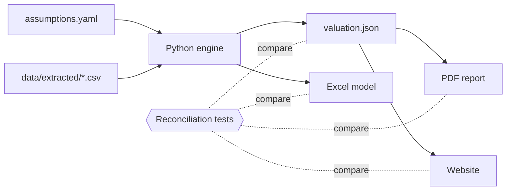

# Shadow valuation of the Domain Holdings takeover

I am valuing Domain Holdings Australia (ASX: DHG) independently, from the information that was available when Grant Samuel gave its report, and comparing my result with the independent expert's range and with CoStar's offer. CoStar acquired Domain by scheme of arrangement at A$4.43 per share, implemented on 27 August 2025, and Grant Samuel valued Domain at A$4.06 to A$4.46 per share.

This is an educational case study, not financial advice, and it is not affiliated with any party to the deal.

## Status

Work in progress. I have chosen the deal, the method and the architecture, and the checks run on every push, but I have not valued Domain yet, so there is no result to report. This README gets its result, links and gap analysis when the valuation is finished. The plan and the task list are in [docs/ROADMAP.md](docs/ROADMAP.md) and [TODO.md](TODO.md).

## Result

Not available yet. This section will give my range and preferred value per share, the A$4.43 offer, and Grant Samuel's A$4.06 to A$4.46, with links to the site, the Excel model and the PDF report.

## What I am building

- A Python engine that reads one file of inputs, `assumptions.yaml`, in which every input carries its source, page and date.
- An Excel model whose cells are live formulas, checked by a test that recalculates the workbook and compares it with the engine.
- A website, built from the same numbers, with a football field chart of my ranges against the expert's range and the offer price, and a source for every figure.
- A short PDF report built from the same numbers.

## The three methods

- Discounted cash flow: forecast Domain's free cash flow, discount it at a rate that reflects its risk, and add a terminal value for the years after the forecast.
- Trading comparables: apply the earnings multiples of listed peers to Domain's earnings, then adjust for the control premium a buyer pays.
- Precedent transactions: apply the multiples paid in comparable takeovers.

[docs/RESEARCH.md](docs/RESEARCH.md) explains the methods with one worked example, and how Australian independent experts' reports are regulated.

## Where I differ from the expert

Not available yet. This section will show the bridge from the midpoint of Grant Samuel's range to my value, with one step for each difference in an assumption.

## How the numbers are produced



The reasons for each choice are in [docs/ARCHITECTURE.md](docs/ARCHITECTURE.md) and [docs/DECISIONS.md](docs/DECISIONS.md).

## Sources and limitations

Market data comes from the scheme booklet and company filings, and I link to those documents instead of copying them. I found no FY25 accounts that Domain published on the ASX before it left the Official List, so my latest actual figures are for the six months to 31 December 2024. The documents I could not verify are listed in [docs/RESEARCH.md](docs/RESEARCH.md).

## Run it locally

You need Python 3.12.

```
python -m venv .venv
.venv/bin/python -m pip install --require-hashes -r requirements.lock
.venv/bin/python scripts/check.py
```

On Windows the interpreter is `.venv\Scripts\python.exe`. The last command runs the format check, the linter, the type checker and the tests, builds the PDF report and the site, and prints one summary line. The report needs [Typst](https://github.com/typst/typst/releases/tag/v0.15.1) 0.15.1, on the path or named in the `TYPST` variable.

## Licence

The code is under the MIT licence (see [LICENSE](LICENSE)). The documents I link to, such as the scheme booklet and company reports, belong to their owners and keep their own terms.
