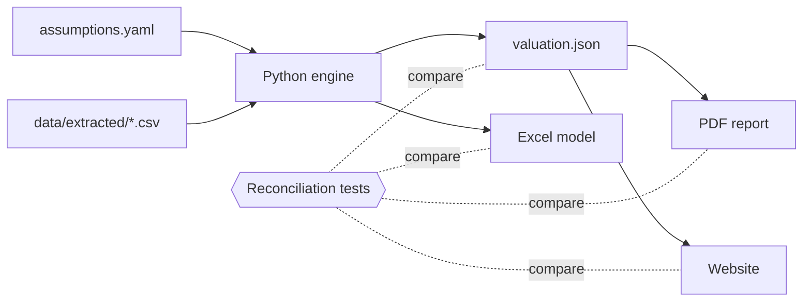

# Shadow valuation of the Domain Holdings takeover

My valuation range for Domain Holdings Australia (ASX: DHG) is A$3.71 to A$4.75 a share, with a preferred value of A$4.21. CoStar Group's A$4.43 cash offer, implemented on 27 August 2025, is inside my range and above my preferred value; Grant Samuel, the independent expert, valued Domain at A$4.06 to A$4.46.

- Site: https://shivanisrinivasanln-git.github.io/asx-takeover-valuation/
- Excel model: https://shivanisrinivasanln-git.github.io/asx-takeover-valuation/downloads/domain_valuation_model.xlsx
- PDF report: https://shivanisrinivasanln-git.github.io/asx-takeover-valuation/downloads/domain_valuation_report.pdf

This is an educational case study, not financial advice, and it is not affiliated with any party to the deal.

## The three methods

I value Domain at 31 December 2024, the expert's valuation date. My preferred value weights the middle value of the discounted cash flow at 50% and of each multiples method at 25%, and my range applies the same weights to the low values and to the high values.

Discounted cash flow. I forecast free cash flow from the second half of FY25 to FY35 on the expert's scenario A inputs, discount it at 9.5% to 10.5%, the expert's adopted range, and add a terminal value at 4.0% growth. The value is A$3.47 to A$4.26 a share, and A$3.83 at 10.0%.

Trading comparables. I apply 16.3x to 19.1x, the forecast EBITDA multiples of SEEK and Rightmove (the two lowest of the expert's eight peers), to FY26 adjusted EBITDA of A$152.2m, and add a 25% control premium at enterprise value level because peer multiples come from minority share prices. The value is A$4.57 to A$5.42, and A$5.00 at the midpoint.

Precedent transactions. I apply 15.2x to 22.3x, the six forecast EBITDA multiples of the deals the expert lists, less the highest and the lowest, to the same earnings, with no premium because a takeover price already includes control. The value is A$3.33 to A$5.04, and A$4.19 at the midpoint.

## Where I differ from the expert

Grant Samuel published a range and no preferred value, so the bridge starts at A$4.26, the midpoint of its range, and swaps one group of inputs at a time from the expert's value to mine.

| Step | Change (A$ a share) | Value after the step (A$) |
|---|---|---|
| Midpoint of the expert's range | | 4.26 |
| Reconstruction difference | −0.0003 | |
| Method weights | −0.21 | 4.05 |
| Discount rate range | 0.00 | 4.05 |
| Revenue, margin, capital expenditure and working capital forecast | 0.00 | 4.05 |
| Terminal growth rate | 0.00 | 4.05 |
| Trading comparables multiple range | −0.08 | 3.97 |
| Precedent transactions multiple range | −0.02 | 3.95 |
| Control premium on trading comparables | +0.27 | 4.21 |
| Net debt and diluted share counts | 0.00 | 4.21 |
| My preferred value | | 4.21 |

The total gap is A$0.05, and two steps much larger than it pull in opposite directions. Weighting my DCF at 50% lowers the value by A$0.21, because the DCF alone gives A$3.83. The 25% control premium on the trading method raises it by A$0.27. My result therefore depends most on the method weights and the premium, and the site explains each step with its booklet pages.

## How the numbers are produced



Every input is in `assumptions.yaml` with the document, page and date it comes from. The engine in `src/valuation/` writes `valuation.json`, the Excel model with live formulas, the site and the report. Tests compare each named cell of the Excel model with the engine to A$0.005 a share, every figure on the built pages with `valuation.json`, and every figure in the PDF with the same values. The reasons for each choice are in [docs/DECISIONS.md](docs/DECISIONS.md) and the architecture is in [docs/ARCHITECTURE.md](docs/ARCHITECTURE.md).

## Sources and limitations

The inputs come from the Domain scheme booklet, which holds Grant Samuel's report, Domain's filings, the RBA's 10-year bond yield and the takeover premium study named in the input register; I link to those documents instead of copying them. I found no FY25 accounts that Domain published on the ASX before it left the Official List, so my latest actual figures are for the six months to 31 December 2024. The peer and deal multiples are Grant Samuel's printed figures, and I have not recomputed them from company accounts. Everything I could not verify is listed on the method page of the site, in the report and in [docs/RESEARCH.md](docs/RESEARCH.md).

## Run it locally

You need Python 3.12, and Typst 0.15.1 for the PDF report.

```
python -m venv .venv
.venv/bin/python -m pip install --require-hashes -r requirements.lock
.venv/bin/python scripts/check.py
```

On Windows the interpreter is `.venv\Scripts\python.exe`. The last command runs the format check, the linter, the type checker and the tests, builds the PDF report and the site, and prints one summary line. The report needs [Typst](https://github.com/typst/typst/releases/tag/v0.15.1) 0.15.1, on the path or named in the `TYPST` variable, and the browser tests and the preview image use the installed Chrome.

## Licence

The code is under the MIT licence (see [LICENSE](LICENSE)). The report font, Atkinson Hyperlegible Next, is under the SIL Open Font License, with its licence in `report/fonts` and `site/static/fonts`. The documents I link to, such as the scheme booklet and company reports, belong to their owners and keep their own terms.
