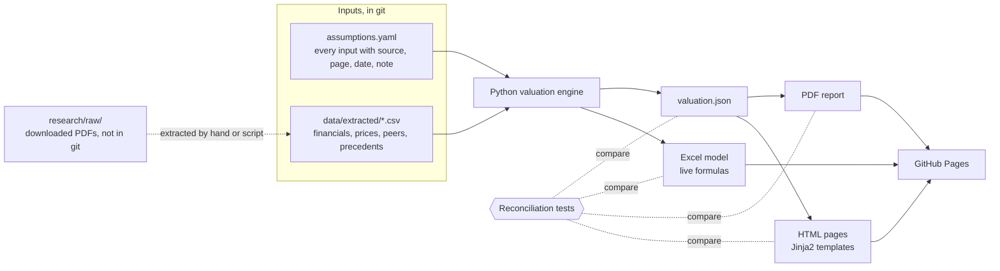

# Architecture

How my valuation gets from source documents to the website, the Excel model and the PDF report, and why I built it this way. Tool facts were checked against official documentation on 27 September 2026; the sources are listed at the end.

## Decision

On 27 September 2026 I chose:
- a Python engine that reads one assumptions file and writes `valuation.json` and an Excel model with live formulas, checked against each other by reconciliation tests;
- a site generated by the same Python code from Jinja2 templates (option 3 below), with a little plain JavaScript;
- no automated price downloads: market evidence comes from the scheme booklet and company filings (see [Market data](#market-data)).

## Requirements

The hosting decisions are already made (see [DECISIONS.md](DECISIONS.md)): a GitHub Pages project site, A$0, no custom domain and no analytics. From those and from how the site will be used:

- Fully static output. Pages serves files; it runs no server code and holds no secrets. A published site may be up to 1 GB, with a soft bandwidth limit of 100 GB a month.
- Pages cannot send custom HTTP response headers. Security settings therefore go in the page itself: a Content-Security-Policy meta tag and a referrer meta tag. Headers with no meta equivalent, such as X-Frame-Options and Permissions-Policy, cannot be set. The site has no forms, logins, cookies or third-party scripts, which keeps the exposure small.
- No paid APIs and no API keys, at build time or in the browser.
- Fast on a phone over a mobile connection, because a recruiter will usually open the link from LinkedIn or an email on a phone.
- Stable for years. A recruiter may open the link in 2028, so the deployed site must not depend on any service that can expire, sleep or change its free tier.
- One set of inputs. The website, the Excel model and the PDF must show the same numbers, and a test must fail if they do not.
- Every figure traces to a source document (with page or table) or to a tested calculation.

## What every option shares

The three options differ only in how the website is built. The valuation pipeline is the same in all of them.



### The assumptions file

`assumptions.yaml` holds every valuation input and nothing else: revenue growth, margins, capex, the WACC inputs, terminal growth, the multiples ranges, the control premium, share count and net debt. Each entry has the same fields:

```yaml
risk_free_rate_pct:
  value: 4.30
  unit: pct
  source: Domain scheme booklet, Grant Samuel report
  location: booklet p. 139
  as_at: 30 May 2025
  note: Expert's spot 10-year Commonwealth bond yield
```

A schema check rejects an entry with a missing source, location or unit. Historical data that is not a judgement (reported revenue and the expert's printed multiples) goes in CSV files under `data/extracted/`, each row carrying its source document and page.

### The engine

A Python package reads the assumptions and data, runs the DCF, the trading comparables and the precedent transactions, and writes one file, `valuation.json`, holding every number the site and the PDF display, at full precision. Rounding happens only when a number is displayed. Unit tests cover each calculation with a hand-worked example (the Harbour Industrial example in [RESEARCH.md](RESEARCH.md) is the first fixture).

### The Excel model

The engine also writes the workbook with openpyxl. It writes formulas, not values: an Assumptions sheet filled from `assumptions.yaml`, then DCF, Comparables, Precedents and Summary sheets whose cells are formulas that reference the Assumptions sheet. Anyone who opens the file can change the discount rate and watch the value move. Each output cell has an Excel defined name equal to its key in `valuation.json` (for example `equity_value_per_share_aud_low`), which is what lets a test compare the two mechanically.

openpyxl stores formulas without calculating them ("openpyxl never evaluates formula"), so the reconciliation test first recalculates the workbook with LibreOffice in headless mode, reads the calculated values back, and compares each named cell with the engine's figure. LibreOffice does not recalculate .xlsx files on load by default (its `OOXMLRecalcMode` setting defaults to "never"), so the test runs LibreOffice with its own profile that sets recalculation to "always". The test also fails if any named cell comes back empty or as an error such as `#NAME?`, which catches functions that Excel and LibreOffice handle differently.

The DCF logic therefore exists twice, once in Python and once as Excel formulas, and the test is what keeps the two in agreement. The alternative is to build the workbook by hand and have Python read its inputs and check its outputs. That gives me more practice in Excel but makes the workbook the thing that has to be kept correct, with no unit tests on individual calculations.

### The PDF report

The report is written in Typst, a typesetting tool distributed as a single binary under the Apache-2.0 licence. Typst is still before version 1.0 and minor versions can break templates, so I pin the exact version (0.15.1 at the time of writing). The template loads the numbers with `json("valuation.json")`, so the report prints the engine's figures and cannot be typed out of date. The prose is written by hand in the template.

### Reconciliation tests

| Test | Compares | Fails when |
|---|---|---|
| Engine fixtures | Engine output against hand-worked examples | A calculation changes |
| Excel | Recalculated named cells against `valuation.json` | A formula and the engine disagree by more than the tolerance, or a named cell is empty or an error |
| PDF | Figures extracted from the PDF text against `valuation.json`, formatted for display | The PDF shows a stale or mistyped figure. Extraction has to handle the minus sign, non-breaking spaces and thousands separators; a fixture test proves it works before I rely on it |
| Site | Figures in the built HTML (marked with a data attribute) against `valuation.json` | A page shows a stale or hard-coded figure |
| Source trace | Every assumption and data row has a source and location | An input has no source |
| Gap analysis | My range and the expert's range, with each gap item, add up | The gap bridge does not reconcile |

Tolerances: A$0.005 per share and A$0.05m for dollar amounts, set in one place in the tests. They cover floating-point and Excel's 15-digit precision, not rounding differences, which are avoided by comparing unrounded values.

## Option 1: Next.js static export

Next.js (version 16 at the time of writing) with `output: 'export'` builds every page to static HTML at build time; server components run during the build. Charts (the football field, the sensitivity table, the gap bridge) are rendered as SVG in React components during the build, so the numbers appear before any JavaScript runs. Interactive parts, such as moving the discount rate and seeing the value update, are client components that read `valuation.json`.

- For: I already use Next.js and React, so I can build quickly and explain every part of it in an interview. Large ecosystem, TypeScript throughout.
- Against: every page ships the React and Next.js runtime, so a page loads more JavaScript than it strictly needs. Static export drops features that need a server (the default image optimiser, server actions, rewrites, redirects, `headers()` and proxy, formerly called middleware). A static site needs none of them, but it means a nonce-based Content-Security-Policy is not possible, so the meta-tag policy has to allow inline scripts or use Next.js's experimental hash support. Next.js changes major versions often, so the lockfile pins it and upgrades are deliberate.
- Pages detail: the site lives under `/asx-takeover-valuation/`, so `basePath` is set at build time. Next.js publishes an official GitHub Pages template that deploys the same way.

## Option 2: Astro with React islands

Astro (version 7 at the time of writing, MIT licence) builds static HTML by default and sends no JavaScript unless a component asks for it with a `client:` directive. The interactive parts would be React components loaded as islands; the rest of each page is plain HTML and CSS.

- For: the least JavaScript on a phone of the three options, so the fastest first load. I can still write the interactive parts in React.
- Against: Astro's page and routing model is new to me, so I would spend time learning it and would need to be able to explain it. A smaller ecosystem than Next.js.
- Security: Astro can generate a Content-Security-Policy meta tag with a hash for each script, which avoids allowing inline scripts. Whether this feature is stable or still experimental in Astro 7 is UNVERIFIED.

## Option 3: Python-generated HTML (chosen)

The engine renders the pages itself with Jinja2 templates, with a little plain JavaScript for the interactive parts and charts drawn as SVG by Python.

- For: one language, the fewest dependencies, and nothing to upgrade on the site side. Very fast pages.
- Against: interactivity is harder to build and test without a component framework, and it uses little of my React experience, which is part of what the site shows.

How I build it:
- Every page is rendered to HTML at build time, with the numbers and the SVG charts (football field, sensitivity table, gap bridge) already in the page, so a phone shows the full content before any script runs.
- The interactive parts, such as choosing a discount rate and terminal growth rate and seeing the value, look up values the engine has already calculated and stored in `valuation.json` as a sensitivity grid. The browser does no valuation arithmetic, so there is no third copy of the logic to keep in agreement.
- All JavaScript lives in separate files served from the site itself, so the Content-Security-Policy meta tag can allow scripts from the site only, with no inline scripts.
- The rendered HTML is tested with the same test runner as the engine: each displayed figure is compared with `valuation.json`, and the pages are checked in a headless browser for accessibility and at the four screenshot widths.

## Options ruled out

- Streamlit Community Cloud: runs a server, so it is not static and cannot run on Pages, and it puts the link on a host whose free-tier terms I do not control. Apps with no traffic for 12 hours go to sleep, and the next visitor sees a page asking them to click "Yes, get this app back up!". A recruiter opening the link months later would see that page first.
- Vercel or another host: ruled out when I chose GitHub Pages.

## Where checks run

Locally, one command runs the full check: formatting, lint, Python type checks, unit tests, the reconciliation tests, the site build, and accessibility and screenshot checks on the built pages. My local git hooks run the fast subset before each commit.

In CI, a GitHub Actions workflow runs on every push and pull request: the same product checks (format, lint, type checks, unit tests, reconciliation, build, accessibility with axe on the built pages, a performance budget with Lighthouse CI writing its reports to the job's own files, and a dependency audit). A second job deploys to Pages only from `main` and only when the checks pass, by uploading the built site as a Pages artifact (`actions/upload-pages-artifact` and `actions/deploy-pages`). Third-party actions are pinned to commit hashes. The workflow gets read-only permissions except for the deploy job, which needs `pages: write` and `id-token: write`. No secrets are needed.

LibreOffice (for Excel recalculation) and Typst are installed in CI at pinned versions, and the Excel and PDF files are built in CI from the same commit as the site, so the three always come from the same inputs. I install Typst from its release archive with a checksum check rather than through a community-maintained action.

## Market data

Yahoo Finance no longer serves Domain's share price history, and its terms prohibit automated collection (see section 6 of [RESEARCH.md](RESEARCH.md)). I therefore download no price series:
- Domain's undisturbed price, VWAPs and trading range come from the scheme booklet (booklet pp. 42, 95 and 157 to 158).
- For beta I use Grant Samuel's published evidence (booklet pp. 139 to 140) and test the expert's choice against it. I do not estimate a regression beta of my own.
- I record no peer share prices. The peers' multiples come from Grant Samuel's charts, which are based on share prices at 30 May 2025 (booklet p. 150), and I use those printed values. The investor sites I tried (REA Group and Scout24) show no historical close, and I have not cleared the terms of the price portals for reading by a tool. The cost is that I cannot recompute the multiples on my own EBITDA basis.
- Exchange rates for euros and pounds come from RBA table F11.1.

Each value goes into `data/extracted/` with its source, so the source trace test covers market data too.

Options I considered: Bloomberg, LSEG or SIRCA through UNSW (the same sources Grant Samuel cited, and the only route found to a daily Domain series, but my access as an undergraduate was not confirmed), and Yahoo Finance for peer and index prices (its terms ban automated collection, and it has no Domain history).

## Sources

All accessed 27 September 2026.

- GitHub Pages: [limits and usage policy](https://docs.github.com/en/pages/getting-started-with-github-pages/github-pages-limits), [custom workflows](https://docs.github.com/en/pages/getting-started-with-github-pages/using-custom-workflows-with-github-pages), [project site addresses](https://docs.github.com/en/pages/getting-started-with-github-pages/about-github-pages). No custom headers: GitHub staff replies in [community discussion 54257](https://github.com/orgs/community/discussions/54257) (2 May 2023 and 10 July 2024; a forum, not product documentation).
- Next.js: [static exports](https://nextjs.org/docs/app/guides/static-exports), [basePath](https://nextjs.org/docs/app/api-reference/config/next-config-js/basePath), [Content Security Policy](https://nextjs.org/docs/app/guides/content-security-policy), [GitHub Pages template](https://github.com/nextjs/deploy-github-pages).
- Astro: [islands](https://docs.astro.build/en/concepts/islands/), [configuration reference](https://docs.astro.build/en/reference/configuration-reference/), [React integration](https://docs.astro.build/en/guides/integrations-guide/react/), [CSP](https://docs.astro.build/en/reference/experimental-flags/csp/), [licence](https://github.com/withastro/astro/blob/main/LICENSE).
- Streamlit: [app hibernation](https://docs.streamlit.io/deploy/streamlit-community-cloud/manage-your-app).
- openpyxl: [formulas](https://openpyxl.readthedocs.io/en/stable/simple_formulae.html), [defined names](https://openpyxl.readthedocs.io/en/stable/defined_names.html), [PyPI, 3.1.5, MIT](https://pypi.org/project/openpyxl/).
- LibreOffice: [recalculation on load option](https://help.libreoffice.org/latest/en-US/text/shared/optionen/01060900.html), [`OOXMLRecalcMode` default in the configuration schema](https://raw.githubusercontent.com/LibreOffice/core/master/officecfg/registry/schema/org/openoffice/Office/Calc.xcs).
- Typst: [repository and licence](https://github.com/typst/typst), [releases](https://github.com/typst/typst/releases), [`json` function](https://typst.app/docs/reference/data-loading/json/).
- Testing: [@axe-core/playwright licence (MPL-2.0)](https://github.com/dequelabs/axe-core-npm/blob/develop/LICENSE), [Lighthouse CI (Apache-2.0) and its upload targets](https://github.com/GoogleChrome/lighthouse-ci/blob/main/docs/configuration.md).
