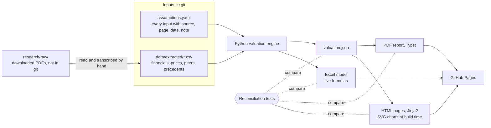

# Roadmap

My plan for the shadow valuation of Domain Holdings Australia (ASX: DHG), acquired by CoStar at A$4.43 per share and implemented on 27 August 2025. Hour figures are my estimates of focused work, written before any build task has been timed, and I will re-estimate after phase 0. This is a draft until I approve it (task R-06 in [TODO.md](../TODO.md)). The task list is in the same file. The reasons behind the choices are in [DECISIONS.md](DECISIONS.md), the sources in [RESEARCH.md](RESEARCH.md), the pipeline in [ARCHITECTURE.md](ARCHITECTURE.md) and the visual direction in [DESIGN_RESEARCH.md](DESIGN_RESEARCH.md).

## Goal and success criteria

I will value Domain independently, compare my range with Grant Samuel's range (A$4.06 to A$4.46) and the A$4.43 offer, and explain each material gap. Everything is built so that I can defend every number in an interview.

What a reader gets:
- Recruiter, 30 seconds on a phone: one sentence stating where my range sits against the offer and the expert's range, the football field chart under it, and three routes onward (how I valued it, where I differ from the expert, download the model and report).
- Hiring manager, 5 minutes: the DCF with its sensitivity table, the comparable companies and precedent transactions tables, the gap bridge from the expert's value to mine, the assumption register with a source for every input, and the Excel model with live formulas.
- Interviewer, any single number: a marker on each figure opens its document, page and date, and I can explain the calculation behind it without notes.

What I can discuss in an interview: why a control premium belongs in a valuation for a takeover and not in a trading multiple; how the expert's discount rate was built and which input I would change; why the DCF and the capitalised earnings approach agree or differ; what each gap item is worth per share; and what I could not verify.

Success criteria:
- The deployed site, the Excel model and the PDF show the same numbers, and a test fails if they do not.
- Every figure traces to a document (with page or table) or to a tested calculation.
- Lighthouse on mobile: performance 90 or more, accessibility 95 or more, best practices 95 or more, and zero axe violations on every page.
- The gap bridge adds up: my preferred value, the expert's value and the listed differences reconcile to the cent.
- I can explain the largest gap in 60 seconds without notes.

## Scope

MVP, which must be finished before anything else is added:
- One deal, Domain, with the valuation date 31 December 2024 and the information available to the expert.
- A DCF, trading comparables and precedent transactions, each with a low, high and preferred value.
- The football field chart, the gap analysis, the assumption register and the deal timeline.
- A downloadable Excel model and PDF report, and a deployed site on GitHub Pages.

Version 2:
- DCF controls on the site that look up a precalculated grid of discount rates and terminal growth rates, with the scenario held in the URL.
- A print-ready memo view of the landing page and valuation page.
- The share price and offer chart rebuilt from the booklet's disclosed prices.
- "Use the expert's assumptions" and "Reset to my base case" buttons on the DCF.

Stretch, in order of value:
- A dashboard of ASX control transactions in FY26 (offer premiums, structures and expert conclusions), built from the same extraction approach. I would only start it after the MVP is deployed, and I rate it the largest piece of extra work.
- My own regression beta, if I get daily Domain prices through UNSW databases.
- A second deal as a short comparison page.

Out of scope: marketing sections, accounts, analytics, anything that needs a server, and any valuation advice.

## Architecture

The pipeline is described in [ARCHITECTURE.md](ARCHITECTURE.md). One assumptions file feeds a Python engine, which writes `valuation.json` and an Excel model with live formulas. The website and the PDF read the same numbers, and tests compare all four.

## Phases

| Phase | Name | Estimate | Milestone |
|---|---|---|---|
| 0 | Setup | 10 h | One command runs the full check, and CI runs it on every push |
| 1 | Deal review | 12 h | I can explain the deal and the expert's method from memory |
| 2 | Data collection and extraction | 20 h | `assumptions.yaml` and `data/extracted/` are complete and every row has a source |
| 3 | Valuation model | 30 h | Engine, `valuation.json` and the Excel model agree within tolerance |
| 4 | Reconciliation and gap analysis | 15 h | My range is set and the gap bridge reconciles |
| 5 | Website | 32 h | All pages built, accessible and within the budgets |
| 6 | Write-up and packaging | 14 h | PDF, README and interview material are done |
| 7 | Deploy, QA and launch | 8 h | The site is live, checked on real devices, and linked from my portfolio |

The total is about 141 hours, and version 2 adds about 6. No task in [TODO.md](../TODO.md) is longer than about two hours, and most are shorter, so each phase estimate is below the sum of its task limits. The calendar time depends on my weekly hours, which I have not capped, and on how much I automate scaffolding and checks.

### Phase 0: setup

Python environment with pinned versions, formatting, linting, type checks and a unit test runner behind one full check command; the repository layout; a CI workflow that runs the product checks (format, lint, types, unit tests, reconciliation, build, axe, Lighthouse and a dependency audit) on every push and deploys to Pages only from a green `main`; the README skeleton. Local checks run before each commit. The first fixture is the Harbour Industrial worked example in [RESEARCH.md](RESEARCH.md).

Done when: the full check command passes on a clean clone, CI is green, and a deliberately broken test fails the check.

### Phase 1: deal review

Read Grant Samuel's report from start to finish (booklet pp. 116 to 170) and the booklet's front sections. Build the deal timeline from ASX notices, and write in my own words the expert's method, each DCF assumption, the discount rate build, the comparable set and why each peer was kept or dropped. Learning tasks sit here, because I need to understand the expert's choices before I can disagree with them.

Done when: the timeline has a document link for every event, and I can explain the expert's DCF assumptions and discount rate from memory.

### Phase 2: data collection and extraction

Transcribe the tables listed in [RESEARCH.md](RESEARCH.md) section 6 by hand against the page and check each by a second reading. Copy peer prices for 30 May 2025 with their source and the date I read them. Download the RBA series. Build the assumptions file and its schema, the extracted CSV files and the source trace test. Fix the valuation date, share count and net debt build.

Done when: the source trace test passes, every transcribed total matches the booklet's printed total, and the items I could not verify are listed with a reason.

### Phase 3: valuation model

Engine functions for the DCF, trading comparables and precedent transactions, each with a unit test and a hand-worked example. A sensitivity grid of discount rate and terminal growth. `valuation.json` at full precision. The Excel model written with openpyxl as live formulas and checked by the LibreOffice reconciliation test. A cross-check against the expert's published scenarios where its assumptions are disclosed.

Done when: all engine tests pass, the Excel reconciliation test passes at the A$0.005 per share tolerance, and I can explain every sheet of the workbook.

### Phase 4: reconciliation and gap analysis

Set my base case and my range from the evidence, with each material input argued in writing. Compare my value with the expert's step by step: valuation date, forecasts, discount rate, terminal growth, the multiple applied, the control premium and net debt. Build the gap bridge and its test.

Done when: the bridge reconciles, each step has a short explanation with a source, and I have written the 60-second explanation of the largest gap.

### Phase 5: website

Design tokens first, then the landing page end to end, then the other pages. The football field, gap bridge and sensitivity table as SVG at build time; the provenance marker and the "Show sources" switch. The DCF controls and the print stylesheet are version 2. Screenshots at 390, 768, 1280 and 1440 px after each change. Front-end research feeds the visual polish before the first page is built.

Done when: every page passes axe with zero violations, meets the Lighthouse budgets, and the built HTML matches `valuation.json` in the site test.

### Phase 6: write-up and packaging

The PDF report in Typst reading `valuation.json`, with the same tests as the site. The About page, the README with the executive summary first, and the interview material: the 60-second walkthrough, the explanation of each gap item, and the answers to questions on single numbers.

Done when: the PDF figures match `valuation.json`, the README gives the result in its first paragraph, and I have rehearsed the walkthrough out loud.

### Phase 7: deploy, QA and launch

Deploy from `main` to GitHub Pages, check the live site on a phone and a laptop, check the downloads open, run the final accessibility and performance checks on the live address, review every page for the disclaimer, and link the site from my portfolio and resume. The first deploy to a public address is my decision.

Done when: the live site passes the same checks as the local build, and the links work from a private browser window.

## Risks

| Risk | Mitigation |
|---|---|
| Domain published no FY25 accounts, so the latest actuals are 1H25 | Use the expert's valuation date of 31 December 2024 and its information set, and say so on the site |
| The expert's scenarios A to H are only partly disclosed, so I cannot reproduce its DCF | Build my own DCF, compare outputs and not inputs where inputs are missing, and label what I could not replicate |
| Peer EBITDA is defined differently across companies | Put every peer on one basis, record the adjustments, and show them in the comparables table |
| Beta is hard to measure for Domain and I use no price download | Test the expert's beta range against its published evidence and show the sensitivity of the value to it |
| Transcription errors from PDF tables | Hand transcription, a second reading, totals checked against the printed totals, and the source trace test |
| Excel and LibreOffice treat a function differently | Reconciliation test fails on empty cells and errors, and I avoid functions that differ |
| A site without a component framework is slow to build | Keep the interactive part to a lookup of precalculated values, and build the static content first |
| Links to ASX and company documents stop working | Link to the exact document URL, keep local copies out of git, and note the access date |
| Copyright of third-party documents | Link, never copy; quote sparingly with page numbers; no third-party PDFs in the repository |
| Scope grows into the stretch items | Finish and deploy the MVP first; each stretch item needs a separate decision |

## Packaging

### README structure

1. The result in two sentences: my range and preferred value, the offer, and the expert's range.
2. A link to the live site, the Excel model and the PDF.
3. How the three methods work, in one short paragraph each.
4. Where I differ from the expert, with the gap bridge.
5. How the numbers are produced: the pipeline diagram and the tests that keep the site, model and report in agreement.
6. Sources and limitations, and the disclaimer: educational case study, not financial advice, not affiliated with any party to the deal.
7. How to run it locally.

### Draft resume bullets

The bracketed values come from my own results and I fill them in only when they exist.
- Built an independent valuation of Domain Holdings (ASX: DHG) by DCF, trading comparables and precedent transactions, reaching A$[low] to A$[high] per share against the independent expert's A$4.06 to A$4.46 and the A$4.43 offer.
- Reconciled my value with the expert's report in a [n]-step bridge, attributing A$[x] per share of the gap to [largest item], and built the Excel model with live formulas that a test recalculates and compares with the Python engine.
- Published the work as a static site with an interactive football field chart, an assumption register that traces every input to a document page, and automated checks for accessibility, performance and consistency between the site, the model and the report.

### LinkedIn post idea

A short post on one finding, for example: "I valued the Domain takeover from the scheme booklet alone. My range was A$[low] to A$[high]. The biggest difference from the independent expert was [item], worth A$[x] a share." Link the site, add the football field image with its alternative text, and invite questions on the method. I write the post after the result is final.

### 60-second walkthrough script

1. Ten seconds: what the deal was and the price (CoStar, A$4.43, implemented 27 August 2025).
2. Fifteen seconds: the football field, my range against the expert's and the offer.
3. Fifteen seconds: the one method I trust most and why.
4. Twenty seconds: the largest gap from the expert's value, what causes it, and what it is worth per share.
Rehearse it with the live site open, and have one source marker ready to show.
